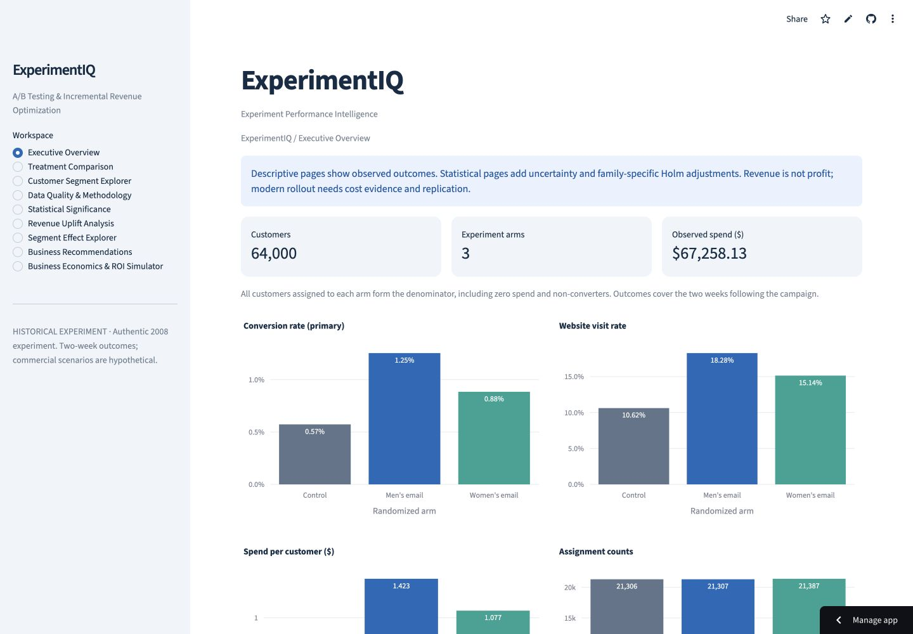
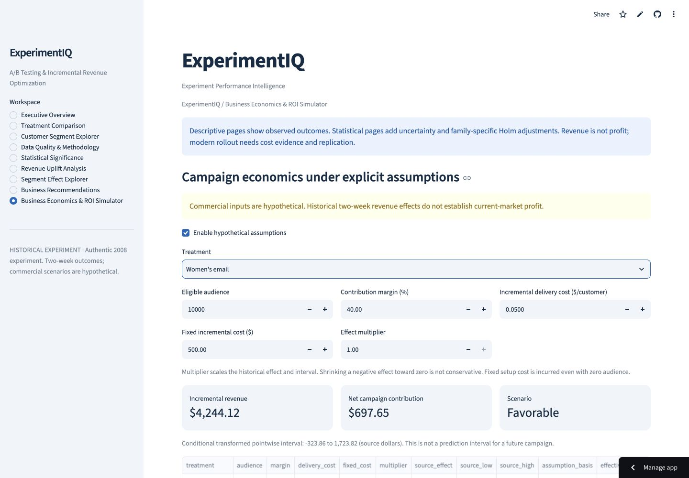
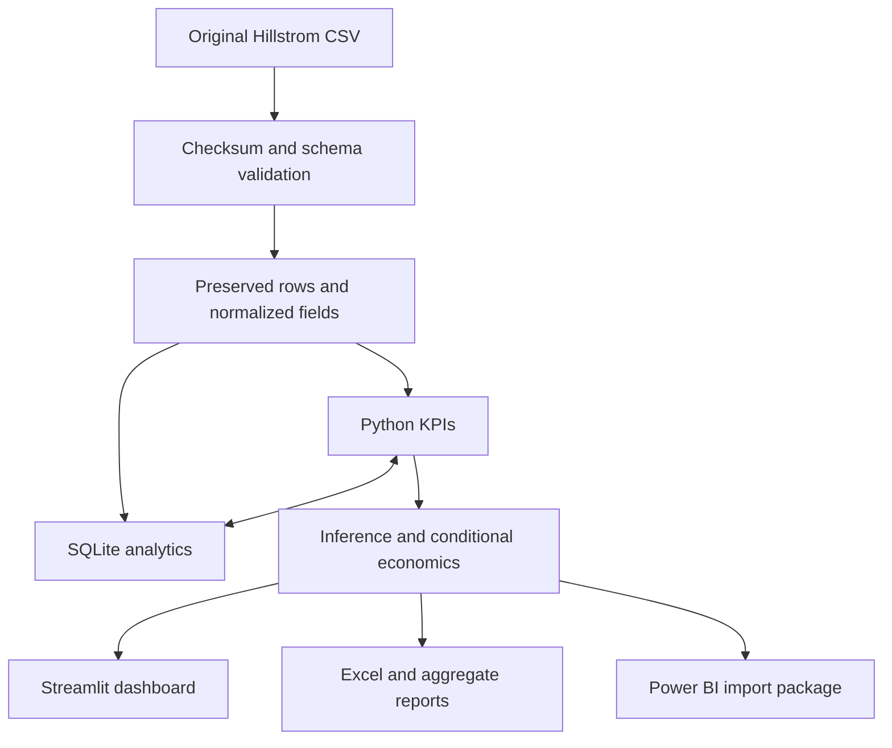

# ExperimentIQ
### A/B Testing & Incremental Revenue Optimization

**Which email should a retailer consider sending, and what evidence is needed before rollout?** ExperimentIQ answers that question with an authentic 64,000-customer randomized experiment, independently reconciled Python/SQL analytics, statistical inference and transparent business scenarios.

[Live dashboard](https://experimentiq-ab-testing-analytics.streamlit.app/) · [Executive case study (PDF)](reports/session4/ExperimentIQ_Final_Case_Study.pdf) · [Excel report](reports/session3/ExperimentIQ_Business_Analytics_Report.xlsx) · [Resume & interview guide](docs/RESUME_AND_INTERVIEW.md)

An independent portfolio project by harshvtomar. Historical experimental evidence, **not a claim of realized profit or current-market performance**.



## Evidence in one minute
Kevin Hillstrom's original MineThatData experiment assigned customers to men's merchandise email, women's merchandise email, or no email. Outcomes cover two weeks. Conversion is primary; visits and spend per assigned customer are secondary.

| Arm | Assigned | Conversion | Visit rate | Spend/customer |
|---|---:|---:|---:|---:|
| Control | 21,306 | 0.5726% | 10.6167% | $0.6528 |
| Men's email | 21,307 | 1.2531% | 18.2757% | $1.4226 |
| Women's email | 21,387 | 0.8837% | 15.1400% | $1.0772 |

Observed spend totals **$67,258.13**. Every denominator includes all assigned customers, including zero outcomes. Dollar labels follow the original source convention.

| Versus control | Conversion difference, pp (95% CI) | Primary Holm p | Revenue/customer difference (95% bootstrap CI) |
|---|---|---:|---|
| Men's email | +0.6805 [0.5014, 0.8641] | 2.3349e-13 | +$0.7698 [$0.4888, $1.0573] |
| Women's email | +0.3111 [0.1502, 0.4745] | 0.000165 | +$0.4244 [$0.1690, $0.6810] |

Binary outcomes: two-sided Fisher tests and Newcombe/Wilson risk-difference intervals. Holm adjusts p-values within declared families; intervals are **pointwise, not multiplicity-adjusted**. Revenue intervals use 10,000 customer bootstrap replications (seed 20261020); revenue p-values use a separate approximate Welch test. The analysis plan is retrospective, not preregistered. [Statistical report](reports/session2/STATISTICAL_REPORT.md) · [Analysis plan](docs/STATISTICAL_ANALYSIS_PLAN.md)

No planned subgroup interaction rejects after Holm across 12 tests. The recommendation is **contemporary randomized replication with measured costs and guardrails**, not immediate rollout or retrospective subgroup targeting.

## What works
- **Python + SQLite:** checksum-pinned retrieval, schema validation, separate normalized fields, 12 SQL analyses, eight KPI fields reconciled independently.
- **Nine-page Streamlit app:** overview, treatment comparison, customer segments, data quality, significance, revenue uplift, segment effects, recommendations and economics simulator. Live filters, charts and 14 custom downloads.
- **Conditional economics:** editable audience, margin, delivery cost, setup cost and effect multiplier; break-even thresholds, sensitivity and conditional intervals. Eleven outputs reconcile with independent SQL arithmetic.
- **Excel:** seven worksheets, 113 formulas, three charts; changed-input and boundary recalculation, export/reopen and LibreOffice verification. Native Microsoft Excel remains unverified.
- **Power BI:** aggregate CSVs, grain/relationship documentation, Power Query import function and DAX specifications. **No verified PBIX, executed DAX or native report rendering.** [Package](powerbi/README.md)
- **QA:** 75 automated tests; fixture-only and authentic-data CI jobs; all nine live pages checked in Chrome. [Detailed evidence](docs/QA.md)

## Business scenarios, not observed profit
The model uses `net contribution = audience × effect multiplier × incremental revenue/customer × margin − delivery cost × audience − fixed cost`.

Illustration only: 10,000 customers, 40% margin, $0.05 delivery/customer, $500 setup, multiplier 1. Men's modeled contribution is $2,079.31 (conditional interval $955.38–$3,229.10); women's is $697.65 (−$323.86–$1,723.82). Original costs and margins are unavailable. These intervals exclude commercial-input uncertainty and transfer to new customers. [Economics contract](docs/ECONOMICS.md) · [Executive business report](reports/session3/EXECUTIVE_BUSINESS_REPORT.md)



## Architecture


Python 3.12 · pandas · NumPy · SciPy · statsmodels · SQLite · pytest · Streamlit · Plotly · GitHub Actions. Excel is generated with Artifact Tool; the PDF uses ReportLab.

## Reproduce
```bash
git clone https://github.com/harshvtomar/experimentiq-ab-testing-analytics.git
cd experimentiq-ab-testing-analytics
python3.12 -m venv .venv
source .venv/bin/activate
python -m pip install -r requirements.txt
python -m src.pipeline
python -m src.statistical_pipeline
python -m src.business_pipeline
EXPERIMENTIQ_REQUIRE_DATA=1 python -m pytest -q
python -m streamlit run app.py
```
Windows PowerShell: activate `.venv\Scripts\Activate.ps1`, then set `$env:EXPERIMENTIQ_REQUIRE_DATA="1"` before pytest. First run requires access to the original data host; later runs verify the cached checksum. Failure to acquire or verify data stops the pipeline. Synthetic fixtures are used only for tests.

- Fixture tests: `python -m pytest -m 'not integration' -q`.
- Real-data CI acquires and validates the original dataset, regenerates inference/economics, then runs integration tests. Missing data cannot silently count as success.
- [Excel rebuild instructions](docs/EXCEL.md) document the separate Artifact Tool runtime requirement.
- PDF: install `reportlab==4.4.9` and run `python scripts/build_case_study.py` after the pipelines. It uses committed aggregate outputs and genuine screenshots. DejaVu Sans fonts are required; set `EXPERIMENTIQ_FONT_DIR` if they are outside `/usr/share/fonts/truetype/dejavu`.

## Data provenance and limitations
[Original challenge](https://blog.minethatdata.com/2008/03/minethatdata-e-mail-analytics-and-data.html) · [Source/license review](docs/DATA_SOURCE.md) · [Data dictionary](docs/DATA_DICTIONARY.md) · [KPI definitions](docs/KPI_DEFINITIONS.md)

Validated 64,000 rows and 12 original fields; no missing or invalid values found. All 6,562 repeated rows after first occurrence remain because original customer identifiers are unavailable. Original spelling is preserved; normalized geography is separate. Source SHA-256: `0e5893329d8b93cefecc571777672028290ab69865718020c78c7284f291aece`.

No explicit redistribution permission was established: raw/customer-level files and SQLite remain outside Git. There are no original assignment logs, timestamps, observed campaign costs, margins or lifetime outcomes. Historical two-week results cannot establish present-day profitability. Source-host availability is a reproduction dependency.

## Verification and maintenance
Session 4 final local regression: **75 passed, 0 failed, 0 skipped**. Final portfolio publication passed [CI run 39669945810](https://github.com/harshvtomar/experimentiq-ab-testing-analytics/actions/runs/39669945810): 64 unit + 11 authentic integration tests. [QA record](docs/QA.md) distinguishes local, browser, hosted and native-tool verification.

Start with [project state](PROJECT_STATE.md), [session log](SESSION_LOG.md) and [maintenance guidance](NEXT_SESSION_PROMPT.md). The four-session portfolio scope is delivered with the native Excel/Power BI limitations stated above; optional future work must preserve existing validated findings.
