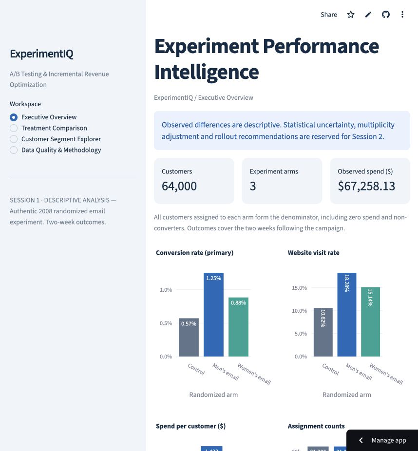
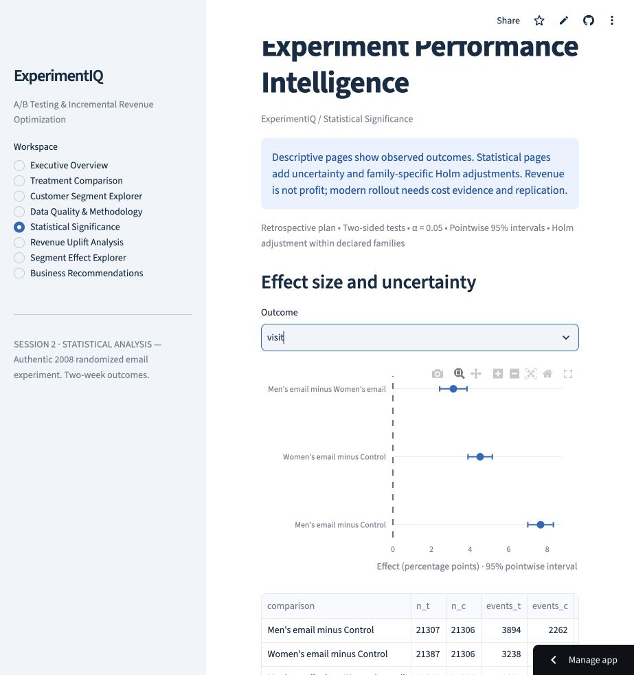
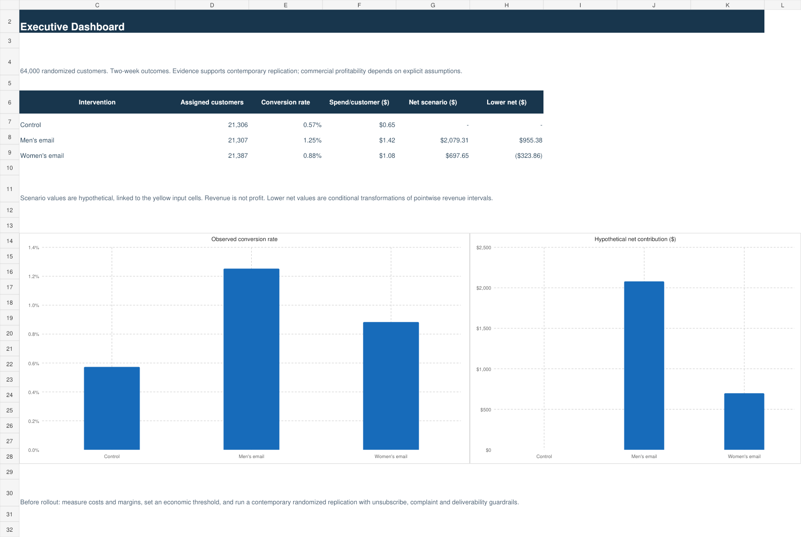

# ExperimentIQ
### A/B Testing & Incremental Revenue Optimization

A reproducible retail experimentation analytics case study built on Kevin Hillstrom's authentic 64,000-customer randomized email experiment. **Sessions 1–2 delivered and live-verified**: binary-outcome inference, declared Holm families, 10,000-replication customer bootstrap, exploratory subgroup interactions and eight interactive Streamlit pages. Hosted verification is recorded in docs/QA.md.

## Business question
Which merchandise email, if any, should a retailer consider deploying to improve purchasing and revenue? Conversion is primary; website visits and two-week spend per assigned customer are secondary. All three experimental arms remain distinct.

## Computed findings
|Arm|Assigned customers|Conversions|Conversion rate|Visit rate|Spend/customer|
|---|---:|---:|---:|---:|---:|
|Control|21,306|122|0.5726%|10.6167%|$0.6528|
|Men's email|21,307|267|1.2531%|18.2757%|$1.4226|
|Women's email|21,387|189|0.8837%|15.1400%|$1.0772|

Observed total spend: **$67,258.13**. Men's email minus control conversion difference: **0.6805 percentage points**; women's email minus control: **0.3111 percentage points**. These observed differences now have formal inference in [the statistical report](reports/session2/STATISTICAL_REPORT.md). They are not proof of profitable rollout. Outcomes span two weeks following the campaign; this is historical evidence, not a present-day revenue forecast.

## Reproduce (Python 3.12)
```bash
git clone https://github.com/harshvtomar/experimentiq-ab-testing-analytics.git
cd experimentiq-ab-testing-analytics
python3.12 -m venv .venv
source .venv/bin/activate
python -m pip install -r requirements.txt
python -m src.pipeline
python -m src.statistical_pipeline
python -m src.business_pipeline
EXPERIMENTIQ_REQUIRE_DATA=1 python -m pytest -q
python -m streamlit run app.py
```
Windows PowerShell activation: `.venv\Scripts\Activate.ps1`; set `$env:EXPERIMENTIQ_REQUIRE_DATA="1"` before running pytest. Network access to the author's dataset is required on first run. Subsequent runs verify the local checksum. A download or checksum failure stops processing rather than using synthetic data.

## Architecture
Original CSV → checksum verification → schema/quality validation → separate normalized fields → canonical Python KPIs and independent constrained SQLite analytics → aggregate reports and Streamlit.

- `src/`: retrieval, validation, preprocessing, metrics, SQLite and pipeline orchestration.
- `sql/`: constrained schema, KPI view and 12 meaningful analyses.
- `app.py`: the four original pages plus Statistical Significance, Revenue Uplift Analysis, Segment Effect Explorer and Business Recommendations. Statistical rendering is isolated in `src/statistical_ui.py`.
- `reports/`: computed aggregate KPIs, quality/provenance/SRM diagnostics, baseline balance and query exports.
- `tests/`: deterministic synthetic unit fixtures and explicitly real-data integration/AppTest coverage.
- `docs/`: business brief, source/license review, data dictionary, KPI contract, methodology and SQL guide.
- `PROJECT_STATE.md`, `SESSION_LOG.md`, `NEXT_SESSION_PROMPT.md`: continuation checkpoint.

## Verified foundation
64,000 rows and 12 original fields. No missing values, unexpected categories or invalid numeric values observed. The 6,562 repeated rows after first occurrence are retained. Original `Surburban` spelling remains; a separate geography field uses `Suburban`. No fabricated customer IDs or timestamps.

All eight numeric arm KPI fields reconcile between SQL and Python. Dashboard calculations reuse canonical functions; filters only use baseline fields, sample sizes accompany comparisons, and empty selections show an explanatory state. Downloads are labeled aggregate CSV/diagnostic JSON exports.

## Data provenance and licensing
[Original challenge](https://blog.minethatdata.com/2008/03/minethatdata-e-mail-analytics-and-data.html) · [TFDS corroborating catalog](https://www.tensorflow.org/datasets/catalog/hillstrom). Retrieved from the original CSV URL; checksum and timestamp are in `reports/provenance.json`. No explicit dataset redistribution license was found. Raw/customer-level data and SQLite are excluded from Git. See [source review](docs/DATA_SOURCE.md).

## Testing and CI
`python -m pytest -m 'not integration' -q` runs fixture-only tests. Real-data tests skip explicitly if data is absent, unless `EXPERIMENTIQ_REQUIRE_DATA=1`, which makes absence fail. GitHub Actions has separate unit and authentic-integration jobs. The latter downloads and verifies the dataset before testing and cannot pass by silently skipping data acquisition. See `docs/QA.md` for actual run results and deployment status.

## Limits and roadmap
No original customer IDs, timestamps, assignment logs, costs, margins or lifetime outcomes. No claim that unadjusted raw means prove efficacy. Segment comparisons are exploratory.

1. **Session 1:** authentic data, Python/SQL foundation, integrity diagnostics and dashboard MVP.
2. **Session 2:** inference, confidence intervals, multiplicity, robust revenue uncertainty and segment interactions.
3. **Session 3:** explicit economics scenarios, Excel executive reporting and Power BI integration where available.
4. **Session 4:** final QA, deployment refinement and portfolio case study.

## Live dashboard and verification
[Open ExperimentIQ](https://experimentiq-ab-testing-analytics.streamlit.app/) — deployed to Streamlit Community Cloud, Python 3.12, branch `main`, entry point `app.py`.

At the Session 1 checkpoint, all four original pages were opened in a real browser. The Web-only filter returned 28,217 customers, independently matching Python. Clearing all channels produced the expected no-data state. All five custom download controls completed: arm KPIs, comparisons, filtered KPIs, baseline balance and quality report. The numerical tables are additionally verified through AppTest and SQL reconciliation. Browser downloads were observed completing; downloaded bytes on the user's computer were not re-read.



Session 1 tests: **23 passed, 0 failed, 0 skipped** (historical checkpoint). [Historical Session 1 CI](https://github.com/harshvtomar/experimentiq-ab-testing-analytics/actions/runs/39309754651): both jobs passed. The final checkpoint changes documentation/screenshots only. See [QA evidence](docs/QA.md) and [Session 3 prompt](NEXT_SESSION_PROMPT.md).

## Session 2 statistical results
The retrospective analysis plan was committed as `2397f9dfb0f227dbfda728b5a11b89b03b9c3b59` before Session 2 inference. It is not preregistration: descriptive outcomes were already known.

|Contrast|Conversion difference, pp (95% pointwise CI)|Primary Holm p|Revenue/customer difference (95% bootstrap CI)|
|---|---|---:|---|
|Men’s email − control|+0.6805 [0.5014, 0.8641]|2.3349e-13|+$0.7698 [$0.4888, $1.0573]|
|Women’s email − control|+0.3111 [0.1502, 0.4745]|0.000165|+$0.4244 [$0.1690, $0.6810]|

Binary tests: two-sided Fisher; risk-difference intervals: Newcombe/Wilson. Each secondary endpoint has its own two-contrast Holm family; three email-versus-email outcomes form an exploratory family. CIs are pointwise, not multiplicity-adjusted. Revenue p-values use a separate approximate Welch test, not bootstrap sign counts. All nine outcome/contrast results, raw/adjusted p-values, relative-effect intervals, sample sizes and assumptions are exported.

No planned interaction remains significant after Holm across 12 tests; do not infer validated subgroup targets. These historical assignment effects support consideration of contemporary replication. Costs and margins remain absent, so economic meaningfulness and profitable rollout are undetermined.

**Reproduction:** `python -m src.statistical_pipeline` generates [strict JSON](reports/session2/inferential_results.json), CSV tables, bootstrap diagnostics and [the statistical report](reports/session2/STATISTICAL_REPORT.md). Seed 20261020, 10,000 customer bootstrap replications, including all zero-spend observations. Full local test suite: **46 passed, 0 failed, 0 skipped**. See [QA evidence](docs/QA.md).

## Session 2 hosted verification
Implementation commit `c582909b345d29e0ca1ed79ba478f4b26f2187b9`: [GitHub Actions run 39378714645](https://github.com/harshvtomar/experimentiq-ab-testing-analytics/actions/runs/39378714645) passed both jobs, with 39 unit and 7 authentic-data integration tests. The hosted job acquired the pinned original data and reproduced inference.

All eight pages opened on the existing live app. Outcome selection, bootstrap comparison selection and both subgroup controls updated their charts; all six new custom downloads completed. No downloaded browser file bytes were independently reread. Numerical payloads are checked by canonical integration tests.



Continue with [the Session 3 prompt](NEXT_SESSION_PROMPT.md) for explicit economics assumptions, Excel reporting and supported Power BI integration.

## Session 3 business economics
The ninth page, **Business Economics & ROI Simulator**, uses editable, explicitly hypothetical audience, contribution margin, delivery cost, fixed setup cost and effect multiplier. It starts without an economic conclusion until assumptions are enabled. Treatment/control comparisons, affine uncertainty intervals, break-even thresholds, three sensitivity charts and CSV exports share `src/economics.py`. All original eight pages remain.

- [Editable seven-sheet Excel workbook](reports/session3/ExperimentIQ_Business_Analytics_Report.xlsx): real formulas, three charts, tested recalculation and source evidence.
- [Executive business report](reports/session3/EXECUTIVE_BUSINESS_REPORT.md): statistical evidence, magnitude and conditional economic decision.
- [Economics formulas](docs/ECONOMICS.md) and [Excel reproduction/verification](docs/EXCEL.md).
- [Power BI integration package](powerbi/README.md): aggregate CSVs, Power Query import function, relationships, DAX specifications and five-page layout. **No verified .pbix report.**

Demonstration only: 10,000 customers, 40% margin, $0.05 delivery/customer, $500 setup, multiplier 1. Men's email net contribution $2,079.31 (conditional pointwise range $955.38–$3,229.10); women's $697.65 (−$323.86–$1,723.82). These are hypothetical scenarios, not observed profit or forecasts.

Local suite: **70 passed**, zero failed/skipped. Python/SQL reconciliation covers 11 economic fields. Workbook reopened and recalculated in Artifact Tool and LibreOffice; native Microsoft Excel remains unverified. Hosted Session 3 CI/live checks will be recorded in docs/QA.md after publication.


